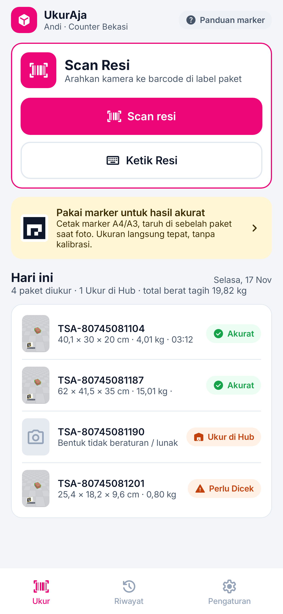
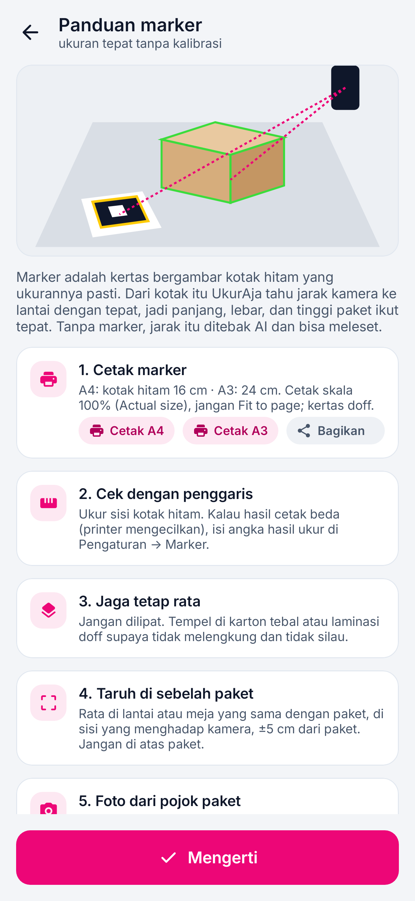
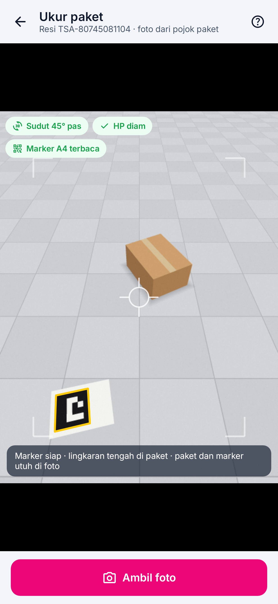
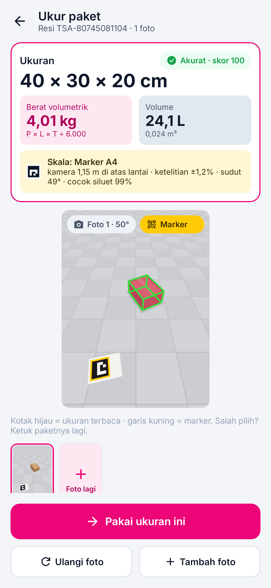
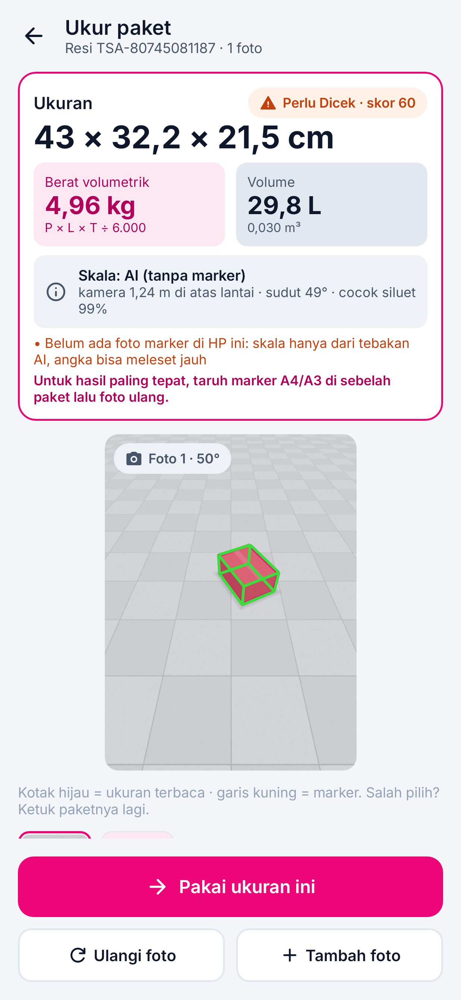

# UkurAja: Android app (v1.0.0)

The field version of UkurPaket's photo mode. It has only what a courier or a counter needs:
- scan the label;
- measure the parcel from a photo;
- weigh it;
- save it with an evidence photo;
- export.

It runs **the same measuring engine** as UkurPaket (the shared `:core` module: MobileSAM-512, Depth Anything V2, box
fit, focus sweep). On top of that engine sits a **printed ArUco marker**. The marker gives the camera height,
which is the one number the photo mode had to guess. With a marker in the photo, the size is right without any
calibration.

Test APK: `../release/UkurAja-1.0.0.apk` (65 MB, app id `id.ukuraja.app`, arm64-v8a + armeabi-v7a, minSdk 26). It is
signed with the debug key: install it directly, and use your own key for Play. Marker sheets: `../marker/UkurAja_marker_A4.pdf` and
`UkurAja_marker_A3.pdf`; the app carries both and prints them through Android's print dialog.

| Beranda | Panduan marker | Kamera: marker terbaca | Hasil dengan marker | Hasil tanpa marker |
|---|---|---|---|---|
|  |  |  |  |  |

The photo screens show the real engine's answer on a synthetic photo (`ScreenshotTest`). The scene is a
40 × 30 × 20 cm carton with the A4 sheet beside it, and the depth model's height is set 30 % off. With the marker
the result is 40,0 × 30,0 × 20,0 cm (Akurat, score 100). Without it the result is 43,0 × 32,2 × 21,5 cm (Perlu Dicek).

## What is in it

| Feature | How it works |
|---|---|
| **Scan Resi** | Google's code scanner reads linear barcodes only, so the label's QR codes are never picked up. **Ketik Resi** takes a typed number. On a Urovo PDA the scan key works too (`HardwareScanner`: Intent or keyboard output). A resi that is already measured opens its record. |
| **Ukur dengan foto** | Steps: stand at a corner of the parcel, take the photo, tap the parcel (or drag a box), read the size. **Tambah foto** from another corner gives the median of all photos. **Ulangi foto** drops a bad photo. |
| **Marker** | A chip in the live camera says **Marker A4 terbaca** (green), **Marker terlalu kecil: dekatkan** (orange) or **Marker belum terlihat**. The sheet is outlined on the preview. When a sheet is in the photo, the focus sweep (up to 6 s of holding still) is skipped. The result card says where the scale came from (**Skala: Marker A4**, with its precision) or **Skala: AI (tanpa marker)**. |
| **Belajar dari foto marker** | Every photo whose scale came from a marker also teaches the phone. It learns the depth model's factor, the courier's standing camera height and the focus factor (`CalSample.fromMarker`, the latest 20 kept). Photos *without* a marker get better too. There is no tape-measure calibration to do. |
| **Berat** | Berat aktual (typed, optional) against berat volumetrik (P × L × T ÷ 4.000 / 5.000 / 6.000); the larger is the **Berat Tagih**. |
| **Bukti** | Every record keeps an evidence photo. It shows the measured 3D box, the parcel's outline, and the marker outlined in yellow with its size (`docs/bukti_foto.jpg`). The record also keeps time, GPS (if allowed) and the operator's name. The numbers cannot be edited. |
| **Ukur di Hub** | For a parcel the photo cannot read: one tap with a reason. The record is saved without a size, and the hub measures it. |
| **Riwayat** | Search by resi; detail; delete; **Ukur ulang** replaces the record. |
| **Ekspor** | **CSV** (semicolon-separated with decimal commas, UTF-8 with BOM, so Excel and Sheets open it as columns). **ZIP**: the CSV plus every evidence photo, `foto/<resi>_<time>.jpg`, named in the CSV. **Data foto untuk analisis (ZIP)**: the raw photo sessions for a PC: photos, masks, depth maps, `shot_N.json` with the markers' corners. |
| **Pengaturan** | Operator name and volumetric divisor. The printed marker sides as measured with a ruler (a printer that shrinks the page is corrected here). Print or share the sheets. Learning from marker photos on/off, and reset. |

Left out on purpose (they stay in UkurPaket):
- ARCore measuring and its device check;
- the DT20 sweep recorder and diagnostics;
- the test mode;
- the tape-measure calibration (the marker does its job).

## The marker

**The sheets** (`tools/marker/make_marker_pdf.py`, vector PDF, exact millimetres):

| Sheet | ArUco id (DICT_4X4_50) | Black square | White round it |
|---|---|---|---|
| A4 portrait | 1 | 160 mm | ≥ 25 mm |
| A3 portrait | 2 | 240 mm | ≥ 28 mm |

Each sheet carries:
- a 10 cm ruler to check the print scale;
- the how-to in Indonesian;
- a small sketch of where to put the sheet.

The two ids differ in at least 8 of 16 bits in every turn, and each differs from its own turns by at least 8 bits, so
one misread bit can never swap them. The generator checks its code table against the app's (`Aruco.kt`).
OpenCV reads the rendered PDFs as id 1 (159,9 mm) and id 2 (239,9 mm).

**How to use it.**
1. Print at 100 % (Actual size), on matte paper; laminate it or glue it to card so it stays flat.
2. Lay it flat on the same floor or table as the parcel, on the side facing the camera, about 5 cm from the parcel.
3. Take the photo from the parcel's corner, with the parcel and the whole black square in the picture.
4. Never put the sheet on top of the parcel.

**Detection** (`core/.../marker/Aruco.kt`, pure Kotlin, no OpenCV: it adds nothing to the APK):
1. Adaptive threshold at two window sizes.
2. Connected regions and their outer contours (Moore tracing), reduced to quadrilaterals (Douglas-Peucker).
3. Each corner refined from the four straight edges of the black border. Along each edge, the steepest white-to-black
   step across it is found to a fraction of a pixel. A line is fitted to those points by total least squares, with
   outliers removed. The corners are where neighbouring lines meet.
4. The 6 × 6 cells read through the homography, split by Otsu's threshold. The border must be black, and the contrast
   must be real. The bits are matched with ids 1 and 2 in the four turns, correcting at most 1 bit.

**Scale** (`MarkerScale.kt`). The engine models the floor as the level plane `up · X = −h` below the camera, with
`up` from the accelerometer, and every size scales with h. Each marker corner's ray meets that plane. For h = 1,
the four sides and two diagonals have lengths d; their true lengths D are s and s√2. So h = Σ dD / Σ d²: the same
model the box fit uses, so the scale is exactly the one it needs. A marker is used only when:
- its sides and diagonals fit within 5 % (a flat, true square);
- its own plane (from its homography) is within 15° of the accelerometer's level;
- it is at least 11 px across in the 480-wide picture;
- the depth map sees it on the same plane as the floor round the parcel. The ratio of the two heights from one
  depth map cancels the model's scale, and must be within 1,22×. This rejects a parcel on a table with the sheet on
  the floor, or the sheet put on top of the parcel.

In `PhotoMeasure.cameraHeight` the marker leads. Any other clue (depth model, focus, standing height) that disagrees
with it beyond what both allow is dropped. Without markers the engine measures exactly as before: UkurPaket's
67 tests are unchanged.

**Tested** (`:core`, synthetic photos with a DT50-like 66° lens, 960 × 1280, anti-aliased, blurred, unevenly lit,
noisy):

| Test | Result |
|---|---|
| 6 poses: camera 0,7–1,5 m, 30–60° down, rolled up to 12°, sheet turned any way, A4 and A3 | corners within 0,03–0,10 px of the truth; camera height within 0,1 %; 25–50 ms per 1,2 MP picture on the PC |
| Blur 1,6 / 2,4 px, noise up to 12 levels, 60 % shading | height within 0,25 % |
| Accelerometer's level 1° / 2° off (pitch) | height 1,3 % / 2,5 % off (roll: none) |
| Sheet propped up 25° | rejected (misfit 5,5 %, tilt 25°) |
| A corner covered; sheet cut by the picture's edge | not detected |
| Other ArUco ids, 300 random rectangles, tiles, noise | no false marker |
| Both sheets in one photo | both found, heights agree (1,300 m) |
| Half-size preview (480 × 640) | found, 6 ms per frame on the PC |
| OpenCV's ArUco detector on the same pictures | same ids and top-left corners on all; its corners 0,2–0,6 px off (sub-pixel refine on), these 0,03–0,10 px |
| Whole measurement: carton 40 × 30 × 20 cm + A4 sheet, depth model's height off by ×1,35 / ×0,70 / ×1,60 | without marker 54,1 × 40,5 × 26,9 / 28,0 × 21,0 × 14,0 / 64,1 × 48,0 × 32,0 cm; **with marker 40,2 × 30,0 × 20,0 / 39,9 × 29,9 × 19,9 / 40,1 × 30,0 × 20,0 cm, Akurat**, no calibration |
| Sheet on the floor, parcel on a table | marker rejected, with the reason |

What synthetic photos cannot show is the DT50's own camera:
- its focal length (it has no factory calibration; 66° is assumed);
- its accelerometer's level;
- real paper and light.

The next ZIP from the phone (Pengaturan → Data foto untuk analisis) is the real check. Each `shot_N.json` holds the
marker's corners.

## Build

```bash
./gradlew :ukuraja:assembleRelease     # ukuraja/build/outputs/apk/release/ukuraja-release.apk
./gradlew :ukuraja:testDebugUnitTest   # flow, export and screenshot tests (screenshots into ukuraja/screenshots/)
./gradlew :core:testDebugUnitTest      # the engine's marker tests
python tools/marker/make_marker_pdf.py marker   # the sheets (reportlab), also copied into ukuraja/src/main/assets/marker/
```
